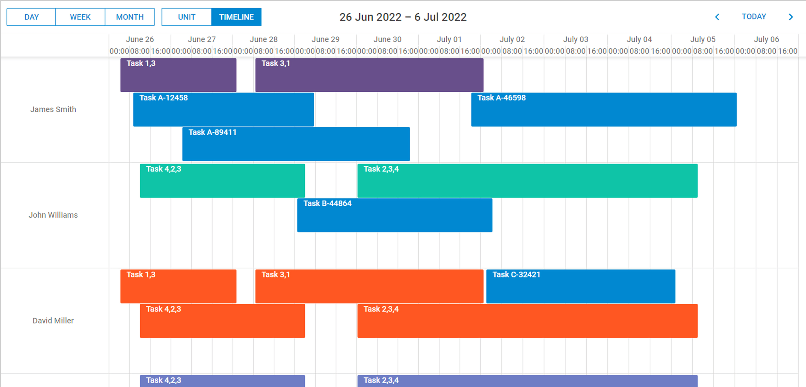

# DHTMLX Scheduler with Angular Demo

[](https://dhtmlx.com/)



## How to start

### Online

[](https://codespaces.new/DHTMLX/angular-scheduler-demo) 

**Please note**, having clicked on this button, you open the **online demo. Don't worry about paying extra!** With GitHub's free plan, [you get 15 GB of storage and 120 hours of Codespaces use each month](https://docs.github.com/en/billing/managing-billing-for-github-codespaces/about-billing-for-github-codespaces#monthly-included-storage-and-core-hours-for-personal-accounts). This is more than enough to run our demo without any extra costs.

### On the local host 

```
yarn 
yarn start
```

## Useful links

- [Full tutorial](https://dhtmlx.com/blog/angular-dhtmlxscheduler-tutorial/)
- [Video Guide](https://www.youtube.com/watch?v=5nGjIvvN_88)
- [Learn about DHTMLX Scheduler](https://dhtmlx.com/docs/products/dhtmlxScheduler/)
- [More demos about the DHTMLX Scheduler functionality](https://docs.dhtmlx.com/scheduler/samples)
- [Technical support](https://forum.dhtmlx.com/c/scheduler-all)
- [Online  documentation](https://docs.dhtmlx.com/scheduler/)

## Follow us

- Star our GitHub repo :star:
- Watch our tutorials on [YouTube](https://www.youtube.com/user/dhtmlx/videos) :eyes:
- Read us on [Medium](https://dhtmlx.medium.com) :newspaper:
- Follow us on [Twitter](https://twitter.com/dhtmlx) :feet:
- Like our page on [Facebook](https://www.facebook.com/dhtmlx/) :thumbsup:
